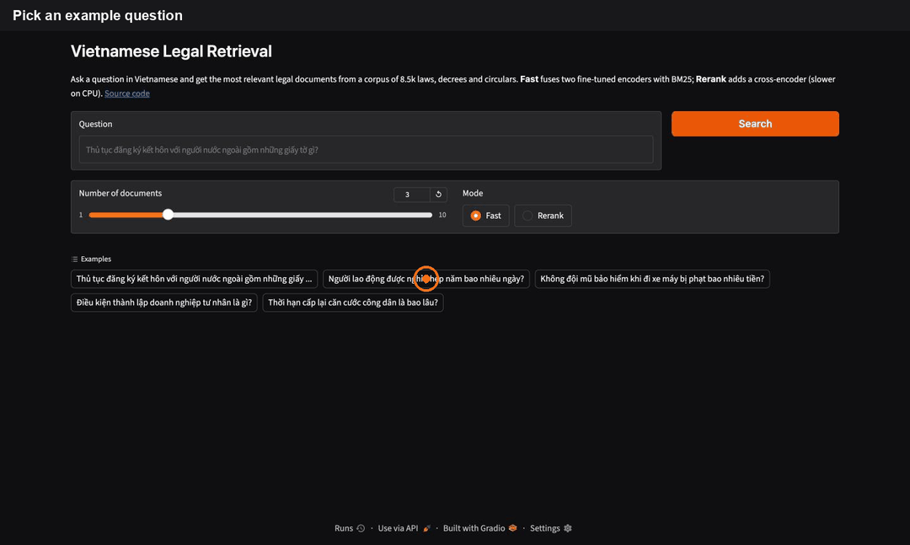
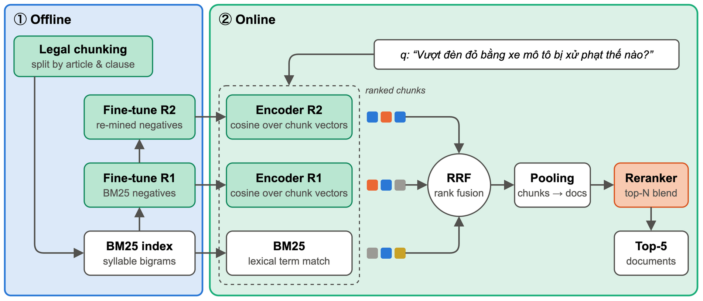
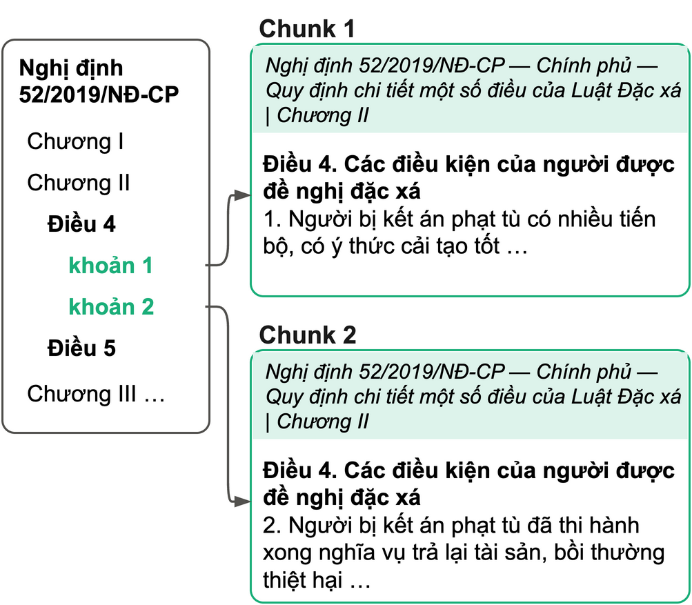

# Vietnamese Legal Retrieval

Ask a question in Vietnamese and get back the legal documents (laws, decrees, circulars) most likely to answer it.



```bash
bash scripts/infer.sh search "Thủ tục đăng ký kết hôn với người nước ngoài?" -k 5
```

Built for the UIT Data Science Challenge 2026 legal retrieval task (8.5k documents, top-5 answers per question):

| | Recall@5 | Rank |
|---|---|---|
| Public leaderboard | **95.5** | 5 / 100 |
| Private leaderboard | **95.0** | 9 / 100 |
| Validation (1,000 questions) | 96.4 | |

## Pipeline



1. **Chunking.** Each document is split along its legal structure into chunks of about 1,000 tokens.
2. **Three retrievers.** Two fine-tuned bi-encoders based on [`AITeamVN/Vietnamese_Embedding`](https://huggingface.co/AITeamVN/Vietnamese_Embedding) and BM25 each rank the chunks.
3. **Fusion.** The rankings are merged with weighted reciprocal rank fusion (RRF), then chunk scores are pooled into document scores.
4. **Reranking.** The top documents are rescored by [`AITeamVN/Vietnamese_Reranker`](https://huggingface.co/AITeamVN/Vietnamese_Reranker), and the reranker score is blended with the fusion score.

## Chunking



- Documents are cut at *Điều → khoản → điểm*, then paragraph and sentence if a piece is still too long.
- Every chunk starts with a header: document number, issuer, title and chapter. A clause from the middle of a document still says which document it belongs to.
- When a long article is split, the later chunks repeat the article heading.
- For BM25, document numbers like `75/2017/NĐ-CP` stay one token, accents are removed and syllable bigrams stand in for Vietnamese word segmentation.

## Ablation

Each stage on the 1,000 validation questions, all other parameters fixed at the tuned values:

| Setup | Recall@5 | MRR |
|---|---|---|
| BM25 | 85.8 | 70.3 |
| Bi-encoder, round 1 (negatives from BM25) | 92.4 | 82.5 |
| Bi-encoder, round 2 (negatives from round 1) | 93.4 | 84.8 |
| RRF fusion of the three | 94.7 | 85.6 |
| Fusion + reranker | **96.4** | **87.6** |

Fusion parameters were tuned on 700 of these questions. On the other 300, the full pipeline gets 95.5. Reproduce with `python -m src.pipeline ablate` (CPU only, reads the cached rankings in `artifacts/`).

## Quickstart

```bash
git clone https://github.com/monster1909/vietnamese-legal-retrieval.git
cd vietnamese-legal-retrieval
pip install -r requirements.txt
```

```bash
bash scripts/infer.sh search "<question>" -k 5                                  # one question
bash scripts/infer.sh predict examples/data/questions.json -o output            # a file of questions
```

Search needs the trained artifacts in `artifacts/` (fine-tuned encoders, embeddings, BM25 index). They are not distributed because they are built from the organizers' data. `bash scripts/train.sh` rebuilds them from the competition data. No GPU? [`notebooks/infer.ipynb`](notebooks/infer.ipynb) runs the same commands on Google Colab. Run a script with `-h` to see all options.

The competition data is not included. [`examples/data/`](examples/data) has a few synthetic files in the same format.

### Demo UI

```bash
python -m demo.app          # Gradio at http://localhost:7860
```

### REST API

```bash
uvicorn api.main:app --port 8000
# or with Docker, artifacts mounted at run time
docker build -f api/Dockerfile -t legal-retrieval-api .
docker run -p 8000:8000 -v ./artifacts:/app/artifacts legal-retrieval-api
```

```bash
curl -X POST localhost:8000/search -H "Content-Type: application/json" \
  -d '{"question": "Người lao động được nghỉ phép năm bao nhiêu ngày?", "k": 3, "rerank": false}'
```

`POST /search` returns `{"results": [{"doc_id", "title", "link", "passage"}, ...]}`; `GET /health` returns `{"status": "ok"}`. `rerank: true` adds the cross-encoder (slower on CPU). The reranker base model is downloaded from Hugging Face on first start. The container needs about 7 GB of RAM; with less it starts swapping and slows down (on Docker Desktop, raise Settings → Resources → Memory).

<details>
<summary>Project layout</summary>

```
src/
├── pipeline.py        CLI: train, tune, evaluate, ablate, predict, search
├── config.py          hyperparameters
├── data.py            loading
├── doc_header.py      parses number / issuer / title from document headers
├── chunking.py        legal-aware chunking
├── mine_negatives.py  hard-negative mining
├── train.py           bi-encoder fine-tuning
├── tune.py            fusion parameter search
├── evaluate.py        metrics
└── retrieval/         bm25, dense, rerank, fusion, scoring, cache
demo/app.py            Gradio UI
api/                   FastAPI service and Dockerfile
scripts/               train.sh, infer.sh
notebooks/             train.ipynb, infer.ipynb (Colab)
examples/data/         synthetic sample data
```

</details>

## Known limitations

- Questions that need several documents are harder than questions with a single answer.
- Three transformer models run per query. On CPU, reranking has to be reduced.
- New or amended laws require re-chunking and re-encoding, and superseded documents are not detected.

## Acknowledgements

Base models: [`AITeamVN/Vietnamese_Embedding`](https://huggingface.co/AITeamVN/Vietnamese_Embedding) and [`AITeamVN/Vietnamese_Reranker`](https://huggingface.co/AITeamVN/Vietnamese_Reranker). Task: UIT Data Science Challenge 2026.
